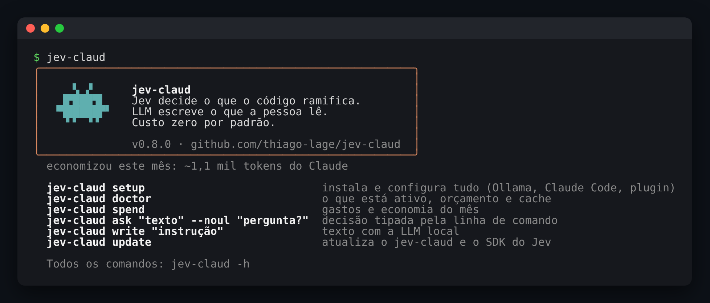
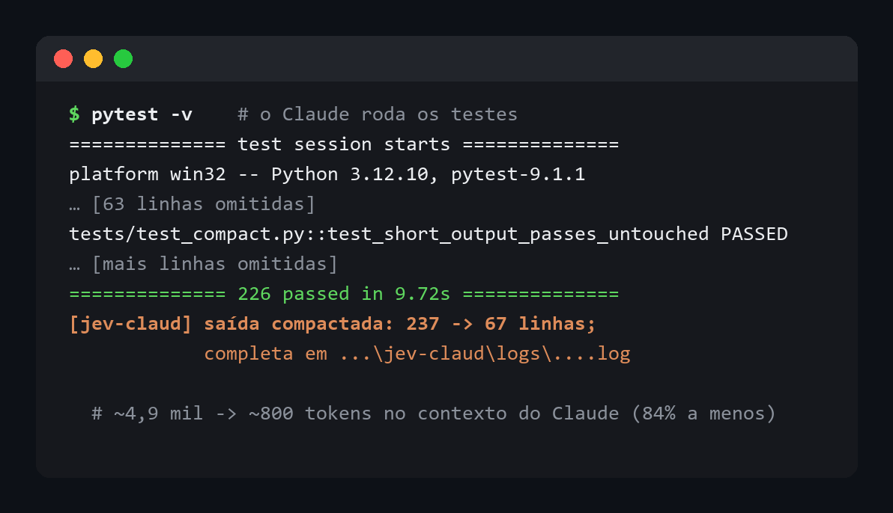
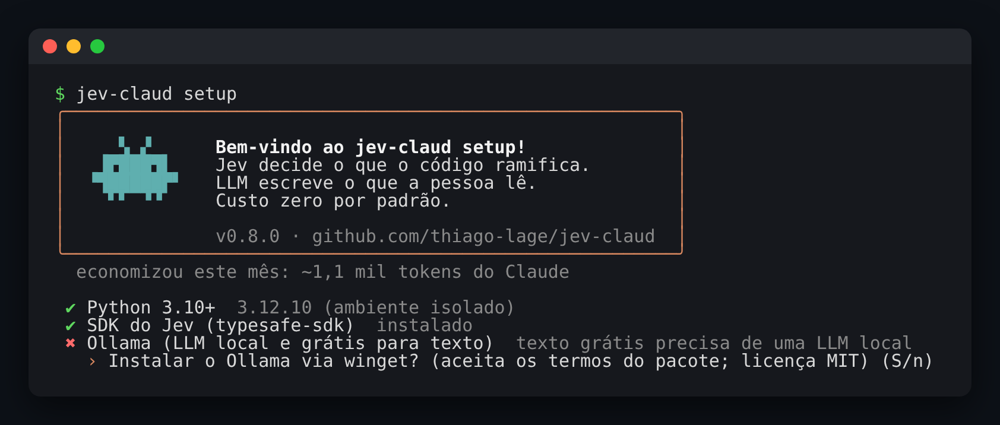
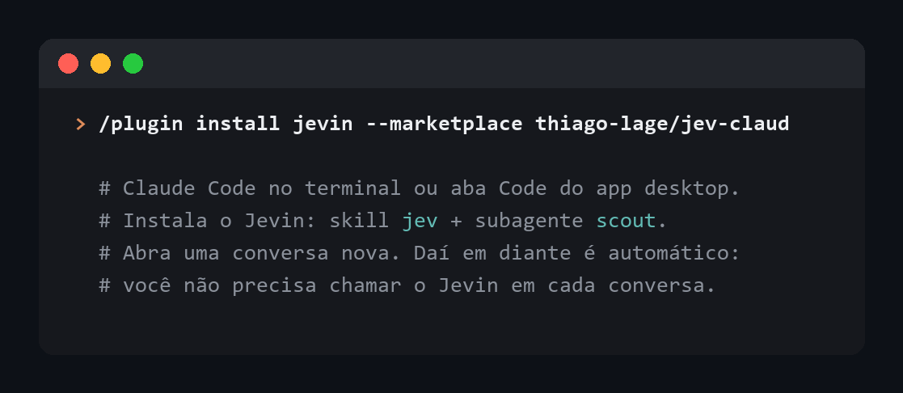

# jev-claud

[](https://pypi.org/project/jev-claud/)
[](https://github.com/thiago-lage/jev-claud/actions/workflows/ci.yml)

**Prepara evidências e reduz ruído para o agente principal. Custo zero por padrão.**

<p align="center">
  
</p>

## Para que serve

O Claude paga, em tokens e em espaço de contexto, por tudo o que lê. Muito disso é ruído:
centenas de linhas de testes passando, arquivos de dados inteiros lidos só para contar ou
filtrar. O jev-claud corta esse ruído **antes** de ele chegar ao Claude e aponta as fontes
para conferência. O agente principal continua planejando, lendo, editando e validando.

No Claude Code, o hook compacta comandos compatíveis automaticamente. As ferramentas MCP
ficam disponíveis para o agente escolher conforme a tarefa; a skill orienta essa escolha.

| O que o jev-claud faz | Quando entra | Quanto economiza |
| --- | --- | --- |
| Compacta saídas de teste e build | O Claude roda `pytest`, `npm test`, `cargo build`... e a saída passa de 80 linhas | 70% a 85% da saída (exemplo abaixo) |
| Processa arquivos de dados fora do contexto | "Quantos dos 2.000 tickets de `tickets.csv` são cobrança?" | Dezenas de milhares de tokens viram ~300 |
| Explora o código num contexto separado | "Onde a autenticação é validada?" | Só a conclusão volta, de um modelo menor |
| Ensina quando usar Jev, LLM ou código puro | O código que você pede usa IA | Sem JSON + parse; a resposta do Jev não é cobrada |

Exemplo real, os testes deste repositório:

<p align="center">
  
</p>

Para ver quanto você economizou no mês: `jev-claud spend` (ou só `jev-claud`).

## Como usar: 2 passos

**1. No terminal**, uma linha instala tudo e abre o assistente, que pergunta antes de cada passo:

```powershell
# Windows (PowerShell)
irm https://raw.githubusercontent.com/thiago-lage/jev-claud/main/install.ps1 | iex
```

```bash
# macOS / Linux
curl -fsSL https://raw.githubusercontent.com/thiago-lage/jev-claud/main/install.sh | bash
```

<p align="center">
  
</p>

**2. O plugin Jevin**, pelo marketplace do projeto. O Jevin ainda não está no diretório de
plugins do Claude: procurá-lo em **Descobrir** sem adicionar o marketplace não acha nada.

- **No Cowork e nas conversas do Claude** (app desktop ou claude.ai): abra **Personalização ›
  Plugins**, clique em **Adicionar › Adicionar marketplace**, informe `thiago-lage/jev-claud` e
  instale o **Jevin**. Ele fica na sua conta e traz a skill, o subagente e as ferramentas MCP
  (essas só em tarefas do Cowork no seu computador, com o pacote do passo 1).

- **No Claude Code** (terminal ou aba Code do app desktop): o assistente do passo 1 já oferece
  instalar. Para fazer à mão:

  <p align="center">
    
  </p>

Pronto. Abra uma conversa nova e trabalhe normalmente. Para conferir se está tudo ativo:
`jev-claud setup --check`.

**Para atualizar**, rode `jev-claud update`. Ele atualiza tudo de uma vez: o pacote, o SDK do
Jev, o plugin Jevin (skill e subagente, inclusive onde ele está instalado por projeto) e a regra
global no `~/.claude/CLAUDE.md`. No fim, ele limpa sozinho o que versões anteriores deixaram:

- o plugin Jevin registrado em projetos cuja pasta foi apagada, e as versões antigas dele no
  cache que nenhuma sessão aberta usa;
- o registro MCP repetido, quando o servidor já vem pelo plugin;
- o hook e os MCPs (Claude Code, Cursor, Codex) que apontavam para outra instalação do
  jev-claud: passam a usar a que acabou de ser atualizada;
- o jev-claud de outro Python que eles usavam, se nada mais o usa. Uma instalação editável (o
  clone de alguém) fica, e sem o atalho `jev-claud` desta instalação o update só avisa;
- chaves do `config.json` que saíram de uso e as pastas da época em que o projeto se chamava
  jev-claude.

Depois, abra conversas novas: as que já estavam abertas continuam com a versão antiga, que sai
no próximo `update`.

### Por que não preciso chamar nada?

Cada peça fica na configuração do Claude Code, que ele carrega sozinho em toda sessão:

| Peça | Onde fica | O que faz em cada conversa |
| --- | --- | --- |
| Hook de compactação | `~/.claude/settings.json` | Reescreve testes e builds para sair compactados, no Bash e no PowerShell (o shell do app desktop no Windows) |
| Ferramentas MCP | plugin Jevin (`plugin:jevin:jev-claud`) ou, sem ele, registro do Claude Code (escopo de usuário) | `classify`, `rank`, `summarize_file`... ficam disponíveis |
| Regra global | `~/.claude/CLAUDE.md` | Diz ao Claude quando usar cada ferramenta e quando responder direto |
| Plugin Jevin | plugins do Claude Code | A skill `jev` entra quando é relevante; o subagente `scout` explora o código |

### Em que sessões funciona

No app desktop, a sessão pode rodar em três lugares:

| Sessão | Funciona? | Ferramentas MCP | Por quê |
| --- | --- | --- | --- |
| **Este computador** | Sim, tudo | Sim | Usa o `~/.claude` e o jev-claud desta máquina |
| **Remote Control** | Sim, tudo | Sim | É uma sessão deste computador, controlada pelo celular ou pela web |
| **Nuvem** | Só o plugin, se o repositório pedir | Só com o pacote instalado lá | Roda numa máquina da Anthropic que clona o repositório: o hook, o MCP e a regra global do seu computador não vão junto |

Na nuvem, o que continua valendo é o plugin: a skill `jev` e o subagente `scout` (Haiku, esforço
baixo). As ferramentas MCP precisam do pacote `jev-claud` instalado na máquina da sessão. Não há
modelo local nem servidor de texto para levar junto: o texto fica sempre com o LLM da sessão.

Para ter o Jevin também nas sessões na nuvem, declare o plugin no `.claude/settings.json` do
repositório (o Claude Code instala os plugins declarados ali):

```json
{
  "extraKnownMarketplaces": {
    "jev-claud": { "source": { "source": "github", "repo": "thiago-lage/jev-claud" } }
  },
  "enabledPlugins": { "jevin@jev-claud": true }
}
```

### O LLM da sessão, sem modelo local

O jev-claud não tem backend de texto próprio: ele opera **dentro do LLM da sessão** em que está
instalado. O trabalho determinístico (ler o arquivo, quebrar em blocos, contar, deduplicar,
cache, cascata offline) roda no servidor MCP; o que precisa de linguagem vai ao LLM da sessão:

| O host oferece MCP sampling? | O que acontece | `status` mostra |
| --- | --- | --- |
| **Sim** (declara `sampling` no `initialize`) | O servidor pede o texto ao host com `sampling/createMessage` e devolve o resultado pronto: resumo, rascunho, rótulos dos itens incertos, a ordem dos melhores candidatos | `llm.mode = "session_sampling"` e o modelo que o host informou |
| **Não** (o Claude Code, hoje) | As ferramentas devolvem o trabalho ao agente, com `mode: "agent"`: os blocos a resumir (paginados), os itens incertos, a tarefa de escrita. Nenhum outro modelo é chamado | `llm.mode = "agent"` e o nome do host |

O host escolhe e cobra o modelo; o jev-claud não tem seletor de modelo nem nada para instalar.

### Esforço: tamanho dos blocos e profundidade

O seletor do app escolhe o modelo e o esforço **do Claude** (Baixo, Médio, Alto, Extra, Máx,
Ultracode). O jev-claud usa os mesmos seis nomes para decidir **quanto trabalho** fazer: o
tamanho dos blocos, a sobreposição entre eles e a profundidade da junção. O modelo é sempre o
da sessão. O Claude escolhe o nível em cada chamada de `summarize_file` e `write`:

| Seletor do Claude | `effort` no jev-claud | Blocos | Junção | Revisão |
| --- | --- | --- | --- | --- |
| Baixo | `baixo` | grandes, sem sobreposição | curta | não |
| Médio | `medio` (padrão) | médios, pouca sobreposição | média | não |
| Alto | `alto` | menores, mais sobreposição | longa | não |
| Extra | `extra` | pequenos, mais sobreposição | longa | não |
| Máx | `max` | os menores, mais sobreposição | a mais longa | não |
| Ultracode | `ultracode` | como `max` | a mais longa | sim |

A **revisão** do `ultracode` é uma passada a mais que confere o resumo final contra os
resumos parciais. Essa revisão não garante fidelidade ao documento original.
Os nomes em inglês também valem (`low`, `medium`, `high`, `xhigh`), assim como
`médio`, `máx` e `máximo`. Em `write`, o esforço define o limite da resposta (400 a 2.000 tokens).

**No modo agente** (`mode: "agent"`), `summarize_file` devolve os blocos do esforço pedido, até
~24 mil caracteres por resposta, com `next_block` para pedir os próximos e `instructions` com o
roteiro (resumir cada bloco, juntar e, no `ultracode`, revisar). Depois de escrever o resumo, o
agente pode gravá-lo com `save_summary`: a próxima chamada com o mesmo arquivo, foco e esforço
devolve o resumo do cache, sem reler os blocos.

**O que deixa o resumo robusto:**

- **O corte cai em parágrafo, linha ou frase**, nunca no meio de uma palavra, e cada bloco
  repete um pedaço do anterior para não perder o que ficou na emenda.
- **A junção acontece em etapas:** se os resumos parciais forem grandes demais, eles são
  juntados em rodadas, e o LLM nunca recebe mais que um bloco de cada vez.
- **Uma parte que falha não derruba o resumo:** ela fica de fora e o resumo avisa
  ("1 de 5 partes falharam").

**Modo offline estrito (`JEV_CLAUD_OFFLINE=1`):**

- o Jev (pago) nunca é chamado, mesmo que exista orçamento configurado;
- um `Writer` que você passar à biblioteca só é aceito se apontar para este computador ou a rede
  local (`localhost`, `192.168.x.x`...);
- `jev-claud doctor` e a ferramenta `status` mostram se o modo está ligado.

**E o Claude?** As respostas do próprio Claude, inclusive o texto pedido por sampling ou feito
no modo agente, continuam gastando o limite do seu plano. O jev-claud faz o trabalho
determinístico de graça na sua máquina e manda ao Claude menos coisa para ler. O subagente `scout` do plugin roda no Haiku
com esforço baixo, então explorar o código também gasta menos.

## Para desenvolvedores: decisões tipadas no seu código

**Decisões tipadas para o código. Texto livre para pessoas. Custo zero por padrão.**

A biblioteca Python `jev-claud` separa as duas saídas de IA que um app tem:

| Quem consome a resposta? | Use | Motor | Por quê |
| --- | --- | --- | --- |
| **O código**, para ramificar (`if`, `match`, roteamento, filtro, ranking) | `decide`, `when`, `switch`, `rank` | [TypeSafe **Jev**](https://docs.typesafe.ai) (System One) | Resposta tipada e calibrada (rótulo, probabilidade, grau). Sem gerar JSON, sem parse, sem tokens de saída pagos. |
| **Uma pessoa**, que vai ler | `write` | LLM: o da sessão (pelo MCP) ou o `Writer` que você passar | Texto natural é o que LLMs fazem bem. |

Regras conhecidas, cálculos e buscas exatas continuam em código puro: a IA entra só onde
falta senso comum semântico.

```python
from jev_claud import JevClaud, Case, choice, noul, score

r = JevClaud()

d = r.decide(
    ticket_text,
    {
        "setor": choice(
            "Qual setor deve atender este ticket?",
            {
                "financeiro": "cobrança, fatura, reembolso, pagamento",
                "suporte": "erro, bug, falha técnica, não funciona",
                "vendas": "compra, plano, preço, upgrade",
            },
        ),
        "urgente": noul("O cliente precisa de ação imediata?"),
        "raiva": score("Quão irritado está o cliente?", ["calmo", "frustrado", "furioso"]),
    },
)

if d["setor"].uncertain:  # confiança baixa -> humano
    enviar_para_humano(ticket_text)
elif d["setor"].is_("financeiro") and d["urgente"].yes:
    abrir_chamado_prioritario()

resposta = r.write("Escreva uma resposta curta e empática para o cliente.", context=ticket_text)
```

### Por que as decisões tipadas economizam

- **Uma requisição, várias decisões.** Perguntas independentes sobre o mesmo estado vão
  juntas em `decide` e rodam em paralelo no Jev: o custo fixo da requisição é pago uma vez.
- **Saída não custa.** O Jev cobra só tokens de entrada (US$ 0,042 por milhão em 2026-10);
  a resposta é um valor tipado, não texto gerado.
- **Cascata.** Com o Jev ligado, cada pergunta passa primeiro pelo modo offline grátis; só as
  que ele não resolve com confiança (padrão: >= 0,8) vão ao Jev, todas numa requisição. O
  óbvio sai de graça, o difícil continua com o Jev. Veja [Cascata](#cascata-pague-só-pelo-difícil).
- **Cache local.** A mesma pergunta sobre o mesmo estado no mesmo modelo sai do SQLite,
  de graça (`source == "cache"`).
- **Orçamento com teto.** Padrão: **US$ 0/mês**. Sem orçamento, tudo roda no backend
  offline gratuito e o log avisa uma vez. Você libera o Jev conscientemente.

> O Jev não tinha plano gratuito documentado quando este projeto foi escrito (2026-10).
> Por isso o padrão é custo zero: o modo offline é uma heurística lexical local, boa para
> desenvolvimento, testes e CI, mas **não substitui o Jev** em produção.

## O que o setup instala

O instalador de uma linha ([Como usar](#como-usar-2-passos)) cria um ambiente isolado, sem mexer
no seu Python, e abre o assistente `jev-claud setup`. Ele funciona como o primeiro `claude` no
terminal: mostra o que falta, explica para que serve e **pergunta antes de instalar cada coisa**:

| Passo | O que faz |
| --- | --- |
| Chave do Jev | Opcional. Guarda a chave e o orçamento mensal em `config.json` (padrão US$ 0). |
| Claude Code | Instalador oficial de claude.ai. |
| Skill TypeSafe | `claude plugin install typesafe@typesafe-ai`. |
| Servidor MCP | Registra o `jev-claud` no Claude Code para delegar lotes e economizar tokens. Se o plugin Jevin já traz o servidor, não registra outro e remove o repetido. |
| Saídas compactadas | Grava no `~/.claude/settings.json` o hook que compacta as saídas longas de testes e builds (detalhes abaixo). |
| Plugin | Instala o plugin **Jevin** (`jevin@jev-claud`): skill, subagente explorador e o servidor MCP. |
| Regra global | Ensina o Claude, no `~/.claude/CLAUDE.md`, quando usar Jev e quando usar LLM. |
| Cursor e Codex | Só se estiverem instalados: as mesmas ferramentas MCP e, no Codex, a mesma regra ([comparativo](#claude-code-cursor-e-codex-o-que-funciona-em-cada-um)). |

```bash
jev-claud setup            # interativo (também abre sozinho no primeiro `jev-claud`)
jev-claud setup --yes      # aceita tudo que não exige digitar nada
jev-claud setup --check    # só verifica; sai com 1 se faltar algo essencial
```

### Instalação pelo PyPI

```bash
pip install "jev-claud[jev]"    # com o SDK do Jev
pip install jev-claud           # só o núcleo: nenhuma dependência, modo offline grátis
jev-claud setup                 # opcional: Claude Code, plugin e regra global
```

O instalador de uma linha e o `jev-claud update` usam a versão lançada no PyPI. Versão em
desenvolvimento, direto do GitHub: `jev-claud update --dev`, ou
`pip install "jev-claud[jev] @ git+https://github.com/thiago-lage/jev-claud"`.

Sem o extra `[jev]` o pacote não tem nenhuma dependência e roda só no modo offline. Prefira
um ambiente virtual: o `typesafe-sdk` exige versões recentes de `anyio`/`h11`, que podem
conflitar com pacotes antigos no Python global.

Exemplo completo, que roda sem configurar nada: [`examples/triagem_suporte.py`](examples/triagem_suporte.py).

## Dentro do Claude: servidor MCP para economizar tokens

O plugin Jevin traz o servidor MCP do jev-claud (`plugin:jevin:jev-claud`, que roda o comando
`jev-claud mcp` do pacote instalado). Sem o plugin, ou se o servidor dele não conectar, o
`jev-claud setup` registra o servidor direto no Claude Code (ou faça à mão):

```bash
claude mcp add -s user jev-claud -- python -m jev_claud mcp
```

Nas próximas sessões o Claude ganha estas ferramentas. O trabalho determinístico roda **fora
do contexto dele**; o que precisa de linguagem fica com o LLM da sessão
([sampling ou modo agente](#o-llm-da-sessão-sem-modelo-local)):

| Ferramenta | O Claude manda | Recebe de volta | Motor |
| --- | --- | --- | --- |
| `classify` | caminho de um arquivo + rótulos | contagens + itens incertos | offline / Jev; incertos no LLM da sessão |
| `rank` | caminho + consulta | só os top_k | offline / Jev; LLM da sessão reordena |
| `summarize_file` | caminho + foco | resumo não verificado e cache, ou os blocos (modo agente) | LLM da sessão |
| `decide` | texto/JSON + perguntas | valores tipados + confiança | offline / Jev; incertos no LLM da sessão |
| `write` | instrução curta | rascunho, ou a tarefa (modo agente) | LLM da sessão |
| `diagnose_log` | caminho do log + código de saída observado | sinais de falha agrupados e linhas originais | Código puro |
| `search_file` | caminho + texto literal | ocorrências com contexto e linhas | Código puro |
| `read_evidence` | caminho + linhas + fingerprint opcional | trecho original; rejeita evidência desatualizada | Código puro |
| `status` | — | LLM ativo (sampling ou modo agente), Jev, cache de resumos e últimas 10 chamadas | — |

### Fluxo de diagnóstico para o agente

O agente executa os testes. O hook do Claude Code preserva o log completo de saídas longas
e também de falhas curtas. O agente chama `diagnose_log` com esse caminho e o `exit_code`
observado, confere os trechos e lê o código relevante antes de corrigir e executar novamente.
Sem MCP, o mesmo diagnóstico está disponível no terminal:

```console
jev-claud diagnose caminho/do/teste.log --exit-code 1 --json
```

O diagnóstico identifica sinais conhecidos (pytest, falhas Jest/Vitest, Go, compiladores,
exceções e npm); não interpreta todos os formatos nem infere causa raiz. Mensagens iguais
são agrupadas, sem confundir ocorrências com quantidade de testes. `needs_agent_review`
devolve a investigação ao agente principal. Sem código de saída, não declara sucesso.

As ferramentas de evidências leem no máximo `max_chars` (padrão 400 mil; máximo 2 milhões).
`source.coverage`, `source.truncated`, linhas cortadas e grupos omitidos informam os limites.
`read_evidence` permite ampliar até 100 linhas dentro da região lida; aumente `max_chars`
ou leia o original com as ferramentas do agente se a região necessária estiver além dela.
Use o `fingerprint` retornado para detectar alterações entre diagnóstico e conferência.

### Contratos de confiabilidade do MCP

- `decide`: confiança baixa devolve `value=null`, `abstained=true` e um `candidate`
  apenas informativo. Negação reconhecida na entrada força incerteza no backend lexical.
  Isso não torna a heurística um modelo semântico; outros erros ainda são possíveis.
- `classify`: `counts` exclui abstenções; os pendentes aparecem em `uncertain_total`.
  Arquivos de classificação/ranking têm um item por linha, limite de 500 itens e não são
  interpretados como CSV completo. Entradas excessivas são recusadas antes de processar.
- `summarize_file`: retorna um objeto com `summary`, `source`, `cached` e
  `verification=unverified`. Confira fatos no original com `search_file`/`read_evidence`.
  Cache em memória de até 16 resumos por sessão, sensível a conteúdo, arquivo, foco,
  esforço e modelos. Reiniciar o servidor limpa esse cache; não é processamento incremental.
- A API Python continua retornando objetos `Decision` com seus candidatos e faixas de
  confiança. Quem a consome deve tratar `uncertain` e definir o caminho de abstenção.

Monitor contínuo no terminal, processamento incremental, cancelamento de inferência e
adaptador específico para Antigravity ainda não estão implementados. Ter MCP configurado não comprova que um agente
está conectado; a atividade mostrada em `status` pertence somente ao servidor consultado.

**Onde a economia é real:** tudo que o Claude lê ou escreve custa tokens. Se você pede
"classifique os 2.000 tickets de `tickets.csv`", ler o arquivo custaria dezenas de milhares de
tokens. Com `classify`, o Claude envia ~100 tokens (o caminho e os rótulos) e recebe ~200 (as
contagens). O mesmo vale para resumir arquivos grandes e escolher o que vale a pena ler.

**Onde não compensa:** pergunta pequena e única. A chamada da ferramenta e as definições das
ferramentas também custam tokens; o Claude responde direto. No modo agente, `summarize_file`
devolve os blocos para o próprio Claude ler: a economia vem da paginação e do cache, não de outro
modelo. A regra global instalada pelo setup orienta o Claude a fazer essa escolha.

## Saídas de teste compactadas

O `jev-claud setup` grava um hook `PreToolUse` no `~/.claude/settings.json`. Testes, builds e
linters simples (`pytest`, `npm test`, `cargo build`, `go test`, `make`...) passam a rodar via
`jev-claud run`, tanto na ferramenta Bash quanto na PowerShell (a que o app desktop usa no
Windows): saídas acima de ~80 linhas chegam ao Claude com o começo, o fim e as linhas de
erro com contexto. A saída completa fica num arquivo citado no rodapé, e o código de saída é o
do comando original. Custo zero: não usa LLM.

- **Não aprova nada sozinho**: o comando reescrito passa pelas mesmas permissões. Na primeira
  vez o Claude Code pergunta; escolha "não perguntar de novo" para o `... -m jev_claud run`.
- **Conservador**: só mexe em comandos simples; com `|`, `>`, `&&`, `;`, `$(...)` ou em segundo
  plano, nada muda. O `jev-claud run` recusa qualquer comando que não seja teste/build/lint.
- **Desligar**: `JEV_CLAUD_COMPACT=0` (no ambiente ou na frente de um comando).
- Teste real (este repositório, `pytest -v`): 237 linhas viraram 67, com o resumo final intacto.

O hook usa o caminho absoluto do Python do jev-claud, que funciona em todos os sistemas (no
Windows, o Claude Code roda os comandos no Git Bash ou, no app desktop, no PowerShell). Quem
instalou até a 0.9.0 roda `jev-claud setup` de novo: o hook antigo só via o Bash. O setup preserva o resto do
`settings.json` e não mexe nele se o arquivo não for um JSON válido.

### O que o jev-claud roda e envia

Transparência total sobre o que acontece na sua máquina:

- **Roda:** o hook chama `python -m jev_claud hook pre-bash` só quando o Claude Code vai rodar
  um comando no Bash. Se for um teste/build/lint simples, o comando é reescrito para
  `python -m jev_claud run -- <o mesmo comando>`, que o executa, compacta a saída e devolve o
  mesmo código de saída. Nenhum outro comando é alterado. O plugin Jevin não traz código: a
  skill e o subagente são texto, e o servidor MCP que ele inicia é o comando `jev-claud mcp` do
  pacote instalado.
- **Grava (só localmente, na pasta de dados do jev-claud):** a saída completa de cada comando
  compactado (`logs/`, as 20 mais recentes) e contadores de economia por mês num SQLite. Nada sai
  da sua máquina.
- **Envia:** o hook não acessa a rede. A biblioteca e o servidor MCP só enviam texto para a API
  da TypeSafe (Jev) se você configurar uma chave e um orçamento. O texto fica com o LLM da
  sessão (pelo host do MCP) ou com o `Writer` que o seu código passar.
- **Não faz:** não lê credenciais, não altera permissões do Claude Code (o comando reescrito
  passa pelas mesmas perguntas de permissão) e não coleta telemetria.

Detalhes completos, inclusive como apagar tudo: [política de privacidade](PRIVACY.md).

## Plugin do Claude Code: Jevin

O plugin ensina o Claude a poupar contexto **sem mudar a qualidade da entrega**: o Claude
continua implementando direto (edita arquivos, roda testes). Guia completo:
[plugin/README.md](plugin/README.md).

O Jevin ainda não está no diretório de plugins do Claude; ele é instalado pelo marketplace do
projeto, em dois lugares independentes:

**Na sua conta do Claude** (Cowork e conversas): em **Personalização › Plugins** (*Customize ›
Plugins*), **Adicionar › Adicionar marketplace**, informe `thiago-lage/jev-claud` e instale o
**Jevin**. Plugins instalados pelo Claude Code ficam só naquele computador e não aparecem aqui.

**No Claude Code.** No 2.1.275 ou mais novo:

```text
/plugin install jevin --marketplace thiago-lage/jev-claud
```

Em versões anteriores: `/plugin marketplace add thiago-lage/jev-claud` e depois
`/plugin install jevin@jev-claud`.

Se o Claude Code também receber a cópia da sua conta (`jevin@synced`), a do marketplace impede
que ela carregue; o `jev-claud setup` reconhece o `jevin@synced` e remove a cópia duplicada.

O plugin se chama **Jevin**, como o mascote. Até a 0.6 o projeto se chamava
`jev-claude`: quem vem de lá roda o instalador de novo e depois `jev-claud setup`, que troca
marketplace, plugin e MCP antigos pelos novos (o comando `jev-claude` continua funcionando como
atalho).

| Peça | O que faz | Custo |
| --- | --- | --- |
| Skill `jev` | Ensina quando usar Jev, LLM ou código puro, quando as ferramentas MCP compensam e como ler as saídas compactadas. Só entra no contexto quando é relevante | — |
| Subagente `scout` | Explora o código em contexto separado (modelo menor) e devolve só a conclusão com `caminho:linha` | barato |
| Servidor MCP `jev-claud` | Roda o `jev-claud mcp` do pacote instalado e dá ao Claude as [ferramentas](#dentro-do-claude-servidor-mcp-para-economizar-tokens) `classify`, `rank`, `summarize_file`... Sem o pacote, aparece como falho e o resto funciona | — |

Funciona no Claude Code e no Cowork; nas conversas do claude.ai, só a skill. Até a 0.7 o hook de
compactação vinha no plugin; desde a 0.8 ele é instalado pelo `jev-claud setup` (rode-o de novo
depois de atualizar).

## Claude Code, Cursor e Codex: o que funciona em cada um

| Recurso | Claude Code | Cursor | Codex |
| --- | --- | --- | --- |
| Ferramentas MCP (`classify`, `rank`, `summarize_file`, `decide`, `write`) | Pelo plugin Jevin (ou pelo setup, sem o plugin) | Automático pelo setup; ligue em *Settings › Tools & MCP* | Automático pelo setup |
| Regra "Jev ramifica, LLM escreve" | Automático (`~/.claude/CLAUDE.md`) | Manual: `jev-claud rule` e cole em *Settings › Rules* | Automático (`AGENTS.md`) |
| [Saídas de teste compactadas](#saídas-de-teste-compactadas) | Automático no Bash e no PowerShell (hook que não aprova nada sozinho) | Em desenvolvimento | Em desenvolvimento |
| [Plugin Jevin](#plugin-do-claude-code-jevin) (skill `jev` e subagente `scout`) | Sim: marketplace do projeto | Não | Não |

O plugin Jevin também vale no Cowork (com as ferramentas MCP nas tarefas que rodam no seu
computador) e, só a skill, nas conversas do claude.ai. A biblioteca
Python (`decide`, `write`...) e a CLI funcionam igual em qualquer lugar.

### Como o setup configura o Cursor e o Codex

O servidor MCP do jev-claud funciona em qualquer agente compatível com MCP. Quando o
`jev-claud setup` encontra o Cursor ou o Codex neste computador, ele oferece configurá-los
também, perguntando antes de cada passo, como faz com o Claude Code:

| Passo | Cursor | Codex |
| --- | --- | --- |
| Ferramentas MCP (`classify`, `rank`, `summarize_file`, `decide`, `write`) | `~/.cursor/mcp.json` | tabela `[mcp_servers.jev-claud]` no `~/.codex/config.toml` |
| Regra "Jev ramifica, LLM escreve" | `jev-claud rule` mostra o texto; cole em *Cursor Settings › Rules* (o Cursor não tem arquivo de regras globais) | `~/.codex/AGENTS.md` (ou o `AGENTS.override.md`, se você usa um) |

- No Cursor, reinicie depois do setup e confira em *Settings › Tools & MCP* se o jev-claud está
  ligado.
- O Codex usa `$CODEX_HOME` no lugar de `~/.codex`, se a variável estiver definida.
- O setup preserva o resto de cada arquivo e troca só a entrada do jev-claud (por exemplo, a de
  outro ambiente virtual). Um arquivo que ele não consiga ler com segurança fica como está.
- Os passos do Cursor e do Codex só aparecem no setup quando a ferramenta está instalada (o
  comando no PATH ou a pasta `~/.cursor` / `~/.codex`).

## Configuração (tudo opcional)

O `jev-claud setup` grava `config.json` em `JEV_CLAUD_HOME`. Variáveis de ambiente sempre
têm prioridade sobre o arquivo.

| Variável | Padrão | Efeito |
| --- | --- | --- |
| `TYPESAFE_API_KEY` | — | Chave do Jev ([console](https://console.typesafe.ai/keys)). |
| `JEV_CLAUD_BUDGET_USD` | `0` | Teto mensal para o Jev. `0` = custo zero (offline). Ex.: `1.00` ≈ 23 milhões de tokens de entrada. |
| `JEV_CLAUD_MODEL` | `latest` | `latest` (estável, atualizado pela TypeSafe), `preview` (mais novo), `newest` (descobre e fixa a versão mais nova por 24 h) ou `jev-X.Y.Z` (fixo). |
| `JEV_CLAUD_USD_PER_MTOK` | `0.042` | Preço por milhão de tokens de entrada, caso mude. |
| `JEV_CLAUD_STRATEGY` | `cascade` | `cascade` (offline primeiro, Jev só nos incertos) ou `jev` (tudo no Jev). |
| `JEV_CLAUD_CASCADE_ACCEPT` | `0.8` | Confiança mínima para aceitar a resposta offline. Suba para escalar mais ao Jev. |
| `JEV_CLAUD_CACHE_TTL_DAYS` | `7` | Validade do cache para aliases. Versões fixas não expiram. `0` desliga. |
| `JEV_CLAUD_HOME` | cache do SO | Onde fica o SQLite (cache + gastos). |
| `JEV_CLAUD_OFFLINE` | `0` | `1` nunca chama o Jev e só aceita `Writer` local. |

Não há variáveis de LLM de texto: no MCP o texto fica com o LLM da sessão; na biblioteca, passe
um `Writer` a `JevClaud(writer=...)`.

## API

### Decisões (o código consome)

```python
d = r.decide(state, {"nome": pergunta, ...})   # -> Decisions (Mapping[str, Decision])
r.ask(state, pergunta)                          # -> Decision (uma pergunta só)
```

`state` pode ser texto, dict ou lista. Em dicts, referencie campos nas instruções com
crases: ``"O texto em `ticket.body` pede reembolso?"``.

| Pergunta | Construtor | `Decision.value` | Atalhos |
| --- | --- | --- | --- |
| Uma opção de um conjunto | `choice(instr, {"rótulo": "descrição"})` ou `choice(instr, ["a", "b"])` | rótulo (`str`) | `.is_("a")`, `.probability` |
| Condição sim/não | `noul(instr, yes=..., no=...)` | `bool` (p > 0,5) | `.yes`, `.probability` = p(sim) |
| Grau em níveis ordenados | `score(instr, ["baixo", "médio", "alto"])` | `float` esperado | `.at_least(1.5)`, `.level` |

Toda `Decision` traz `confidence`, `band` (`HIGH`/`MEDIUM`/`LOW`), `probabilities`,
`source` (`jev`/`cache`/`offline`) e `model`. A `Policy(act=0.75, confirm=0.5)` define as
faixas; ajuste ao custo de errar (ação destrutiva pede limiar maior que leitura).

### Ramificação direta

```python
# if semântico
r.when(
    msg,
    "O cliente quer cancelar?",
    then=fluxo_cancelamento,
    otherwise=fluxo_normal,
    uncertain=perguntar_ao_cliente,
)

# match semântico: executa a função do ramo escolhido (recebe a Decision se aceitar argumento)
r.switch(
    msg,
    "Qual a intenção do cliente?",
    {
        "status_pedido": Case("onde está, rastreio, entrega", then=consultar_pedido),
        "reclamacao": Case("problema, defeito, insatisfeito", then=abrir_reclamacao),
        "duvida": Case("como funciona, pergunta sobre produto", then=responder_duvida),
    },
    default=enviar_para_humano,
)

# ranking por relevância (um Score comparável por item, numa requisição só)
for hit in r.rank("como cancelar a assinatura", documentos, top_k=3):
    print(hit.score, hit.item)
```

### Cascata: pague só pelo difícil

Com a chave e o orçamento do Jev configurados, `decide` (e `when`, `switch`, `rank`) segue:

```
1. cache local        mesma pergunta + mesmo estado + mesmo modelo  -> grátis
2. offline            confiança >= JEV_CLAUD_CASCADE_ACCEPT (0,8)  -> grátis
3. Jev (System One)   só as perguntas incertas, numa requisição     -> pago
4. sua Policy         confiança baixa até no Jev -> Band.LOW -> humano/padrão
```

```python
d = r.decide(ticket, {"setor": setor, "urgente": urgente})
d.source  # "offline", "jev", "cache" ou "mixed" (parte offline, parte Jev)
d.escalated  # ("urgente",): o que foi ao Jev
d["setor"].source  # de onde veio cada resposta
```

- O modo offline é conservador: só fica confiante quando o texto tem os termos das opções.
  Descreva cada opção com as palavras que aparecem nos dados reais e mais coisas saem grátis.
- `rank` nunca mistura notas offline e do Jev (não são comparáveis): ou tudo offline, ou tudo no Jev.
- Imagens e `box` vão sempre ao Jev (o offline não enxerga imagens).
- `JEV_CLAUD_STRATEGY=jev` (ou `JevClaud(strategy="jev")`) manda tudo ao Jev, como antes.
- `jev-claud spend` mostra quantas perguntas cada camada respondeu e a economia estimada.

### Imagens (System One com visão)

```python
from jev_claud import Image, box, noul

foto = Image("devolucao_123.jpg")  # caminho ou bytes (PNG/JPEG)
d = r.decide(
    {"pedido": "#123", "foto": foto},  # a imagem pode ir no estado, em listas...
    {
        "danificado": noul("O produto chegou danificado?"),
        "onde": box("Onde está o dano?"),  # Box: localiza algo na imagem
    },
)
if d["danificado"].yes and d["danificado"].confident:
    x0, y0, x1, y1 = d["onde"].region.to_pixels(largura, altura)  # pronto para o Pillow

r.when(f"Comparando {foto} com {Image('original.jpg')}", "A peça foi trocada?")  # ...ou no texto
```

Exigem o Jev com um modelo de visão (`JEV_CLAUD_MODEL`). A imagem é enviada como anexo; o
custo estimado é ~1.500 tokens por imagem. Pela CLI:
`jev-claud ask --image foto.jpg --box "Onde está o dano?"`.

### Texto (uma pessoa lê)

```python
r.write("Resuma o ticket para o time em 3 linhas.", context=ticket, system="Seja objetivo.")
```

Sem `writer`, `write` levanta `NoWriterError`: no servidor MCP o texto vai ao LLM da sessão;
na biblioteca, passe o seu. `CallableWriter(fn)` pluga qualquer SDK e
`OpenAICompatibleWriter(base_url, model, api_key=...)` um endpoint que você escolheu:

```python
from jev_claud import CallableWriter, JevClaud

r = JevClaud(writer=CallableWriter(lambda prompt, system: minha_llm(prompt, system)))
```

### Async

`adecide`, `aask` e `awrite` têm a mesma semântica sem bloquear o event loop.

## CLI

```bash
jev-claud setup                        # assistente: instala e configura tudo
jev-claud mcp                          # servidor MCP (stdio) usado pelo Claude Code, Cursor e Codex
jev-claud rule                         # a regra "Jev ramifica, LLM escreve" para colar em outro agente
jev-claud run -- pytest -x            # roda teste/build e compacta a saída (sem LLM)
npm test 2>&1 | jev-claud compact     # o mesmo, como filtro de texto
jev-claud doctor                       # backends ativos, modelo, orçamento, cache (ou: jev-claud status)
jev-claud ask "Fui cobrado duas vezes" --choice "Qual setor?" -o financeiro=cobrança -o suporte=erro
jev-claud ask "Preciso disso hoje" --noul "É urgente?"
jev-claud models                       # modelos Jev disponíveis na conta
jev-claud spend                        # gastos registrados por mês
jev-claud update                       # atualiza jev-claud, typesafe-sdk, plugin Jevin e regra global
jev-claud refresh                      # só o plugin Jevin e a regra global (o update já chama)
jev-claud cache clear
```

## Como desenhar boas perguntas

Baseado no [guia oficial](https://docs.typesafe.ai/concepts/how-to-build-with-system-one):

1. **Uma decisão estreita por pergunta.** Separe dimensões independentes (setor, urgência,
   tom) em perguntas diferentes, na mesma chamada.
2. **Dê estado suficiente.** Texto-fonte, identidades, políticas e fatos atuais, em campos
   JSON nomeados quando houver várias partes.
3. **Descreva as opções.** Descrições com os termos reais ajudam o Jev e o modo offline.
4. **Inclua um "nenhum"** quando nada puder servir.
5. **Política explícita em código.** Use `confidence`/`band` com limiares testados nos seus
   dados; saída tipada garante a interface, não a verdade.

## Desenvolvimento

```bash
python -m venv .venv && . .venv/bin/activate   # Windows: .venv\Scripts\activate
pip install -e ".[dev]"
pytest
ruff check . && mypy
```

Os testes não fazem chamadas de rede nem gastam nada: o Jev é simulado com os tipos reais
do `typesafe-sdk`, e a LLM de texto com um servidor HTTP local.

## Suporte

Problemas comuns e como pedir ajuda: [SUPPORT.md](SUPPORT.md). Vulnerabilidades:
[SECURITY.md](SECURITY.md). Privacidade: [PRIVACY.md](PRIVACY.md).

## Licença

[MIT](LICENSE). TypeSafe e Jev são marcas da TypeSafe AI; este projeto é independente.
